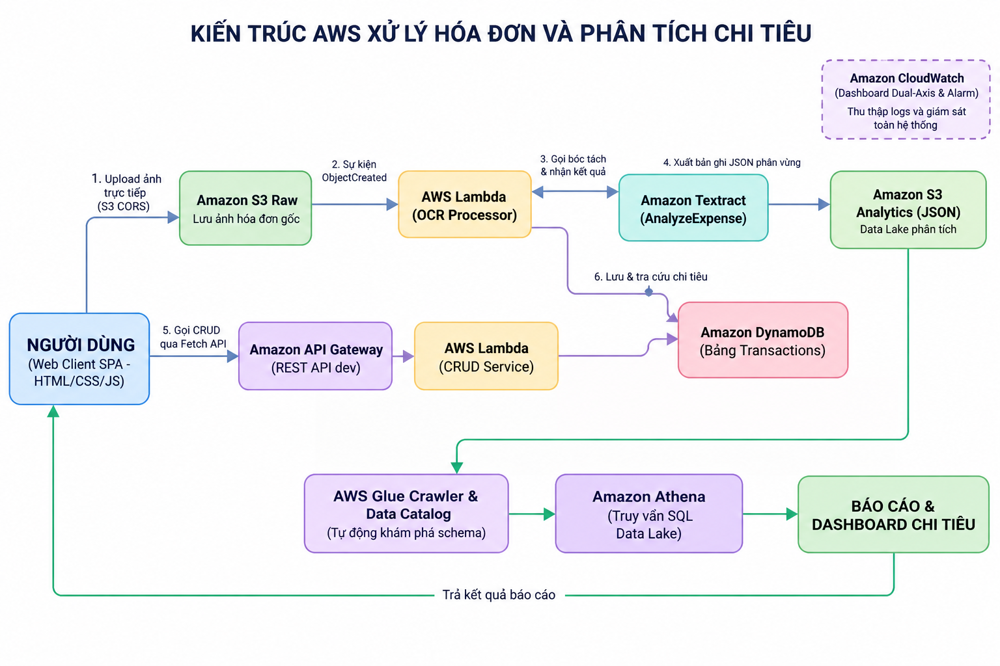
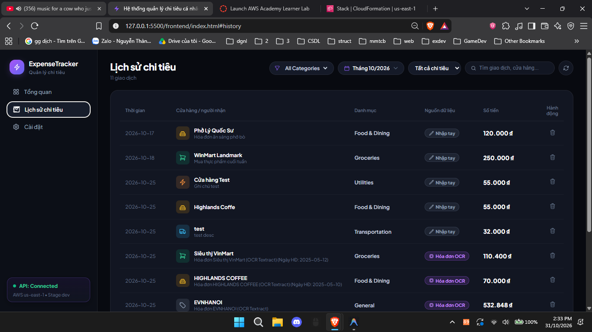
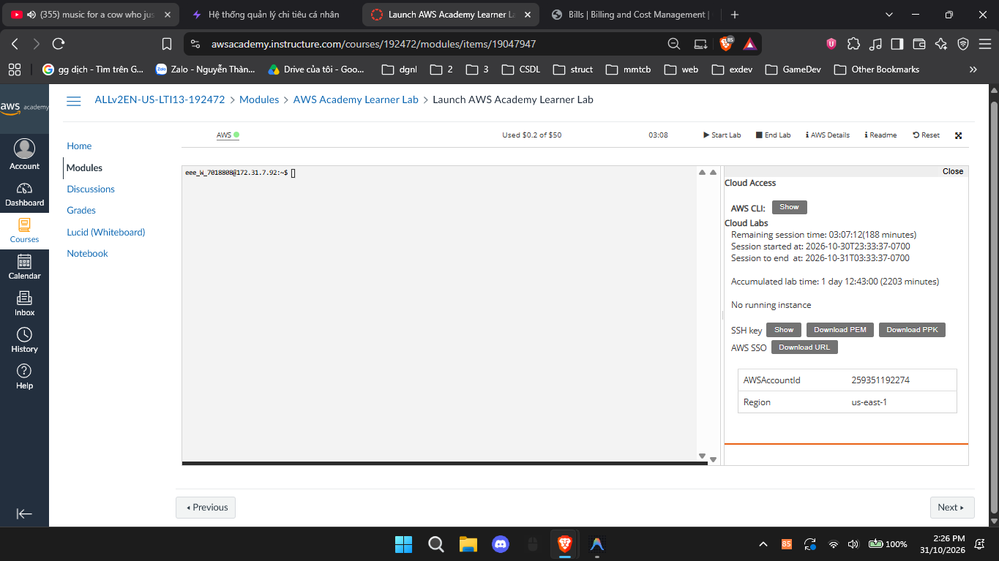
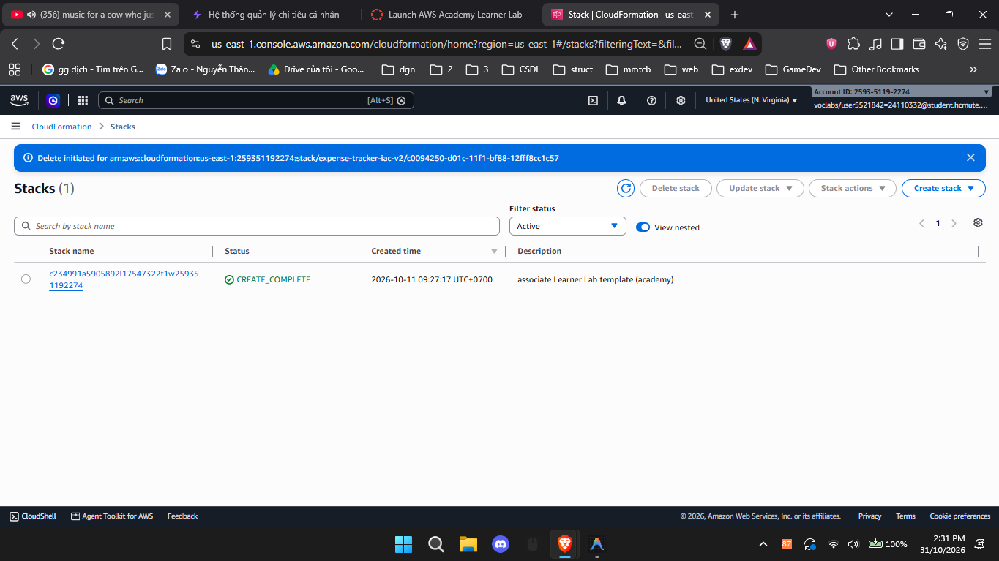

# BÁO CÁO TỔNG KẾT ĐỒ ÁN - NHÓM CAPSTONE
# HỆ THỐNG THEO DÕI VÀ QUẢN LÝ CHI TIÊU CÁ NHÂN THÔNG MINH (SERVERLESS EXPENSE TRACKER TRÊN AWS)

---

## 📌 THÔNG TIN HỌC PHẦN & THÀNH VIÊN DỰ ÁN
* **Học phần:** Điện toán đám mây (Cloud Computing)
* **Giảng viên hướng dẫn:** ThS. Huỳnh Xuân Phụng
* **Nhóm sinh viên thực hiện:** Nhóm Capstone (2 thành viên)
  1. **Lê Trọng Nghĩa** - MSSV: `24110286` - Vai trò: **Sinh viên 1 (SV1)** - Phụ trách: S3 Storage, Chuỗi OCR Textract AnalyzeExpense, Data Lake (AWS Glue Crawler, Glue Data Catalog, Amazon Athena SQL) & CloudWatch Alarm.
  2. **Nguyễn Thành Thắng** - MSSV: `24110332` - Vai trò: **Sinh viên 2 (SV2)** - Phụ trách: Thiết kế CSDL NoSQL DynamoDB, Backend Lambda CRUD Service, Amazon API Gateway, Giao diện Web Client SPA (HTML/CSS/JS), Giám sát CloudWatch Dashboard (Dual-Axis), Infrastructure as Code (IaC CloudFormation) & Tối ưu chi phí.
* **Môi trường triển khai:** AWS Academy Learner Lab (Region: `us-east-1` - US East N. Virginia, Account ID: `2593-5119-2274`)
* **Quy chuẩn Tagging bắt buộc:** `Project: ExpenseTracker` | `Owner: NguyenThanhThang` (hoặc `LeTrongNghia`)
* **Quyền hạn IAM:** `LabRole` (IAM Role được cấp sẵn bởi AWS Academy / Vocareum)
* **Đường dẫn Repository GitHub (Public):** https://github.com/Lypfy/aws-expense-tracker
* **Đường dẫn Video Demo sản phẩm ($\le 10$ phút):** [https://drive.google.com/file/d/1P0wc6t_vyj5OzbL0OTGyZ_y5o0ucI1Ti/view?usp=drive_link](https://drive.google.com/file/d/1P0wc6t_vyj5OzbL0OTGyZ_y5o0ucI1Ti/view?usp=drive_link)

---

## 📑 MỤC LỤC TỔNG THỂ
1. [CHƯƠNG 1: GIỚI THIỆU ĐỀ TÀI & BỐI CẢNH ỨNG DỤNG SERVERLESS TRÊN AWS](#chương-1-giới-thiệu-đề-tài--bối-cảnh-ứng-dụng-serverless-trên-aws)
2. [CHƯƠNG 2: THIẾT KẾ KIẾN TRÚC HỆ THỐNG VÀ CƠ SỞ DỮ LIỆU NOSQL DYNAMODB](#chương-2-thiết-kế-kiến-trúc-hệ-thống-và-cơ-sở-dữ-liệu-nosql-dynamodb)
3. [CHƯƠNG 3: CHI TIẾT HIỆN THỰC KỸ THUẬT VÀ TRIỂN KHAI TRÊN AWS](#chương-3-chi-tiết-hiện-thực-kỹ-thuật-và-triển-khai-trên-aws)
4. [CHƯƠNG 4: KẾT QUẢ KIỂM THỬ LIÊN THÔNG TOÀN DIỆN (E2E SYSTEM TEST MATRIX)](#chương-4-kết-quả-kiểm-thử-liên-thông-toàn-diện-e2e-system-test-matrix)
5. [CHƯƠNG 5: PHÂN TÍCH CHI PHÍ SỬ DỤNG VÀ HIỆU QUẢ KINH TẾ (AWS BILLING)](#chương-5-phân-tích-chi-phí-sử-dụng-và-hiệu-quả-kinh-tế-aws-billing)
6. [CHƯƠNG 6: TỔNG KẾT TIMESHEET 4 TUẦN & MINH BẠCH KHAI BÁO SỬ DỤNG AI](#chương-6-tổng-kết-timesheet-4-tuần--minh-bạch-khai-báo-sử-dụng-ai)
7. [CHƯƠNG 7: KẾT LUẬN, BÀI HỌC KINH NGHIỆM VÀ HƯỚNG PHÁT TRIỂN](#chương-7-kết-luận-bài-học-kinh-nghiệm-và-hướng-phát-triển)

---

## CHƯƠNG 1: GIỚI THIỆU ĐỀ TÀI & BỐI CẢNH ỨNG DỤNG SERVERLESS TRÊN AWS

### 1.1. Đặt vấn đề và Tính cấp thiết của Đề tài
Quản lý tài chính cá nhân là nhu cầu thiết yếu đối với mọi cá nhân trong xã hội hiện đại. Tuy nhiên, phần lớn người dùng gặp trở ngại lớn trong việc duy trì thói quen ghi chép do quy trình nhập liệu thủ công tốn thời gian, dễ quên và thiếu các công cụ phân tích trực quan. Các giải pháp truyền thống dựa trên máy chủ chuyên dụng (EC2) hoặc cơ sở dữ liệu quan hệ (RDBMS) thường gặp các nhược điểm:
* **Chi phí duy trì cố định cao:** Máy chủ phải chạy 24/7 kể cả khi không có lưu lượng truy cập, gây lãng phí tài nguyên.
* **Độ phức tạp vận hành:** Đòi hỏi cấu hình hệ điều hành, vá lỗi bảo mật, quản lý sao lưu và mở rộng quy mô (Auto Scaling).
* **Thiếu khả năng tự động hóa thông minh:** Người dùng vẫn phải gõ từng con số từ hóa đơn giấy vào phần mềm.

### 1.2. Mục tiêu Đề tài & Giải pháp Kiến trúc Serverless
Đề tài **"Hệ thống theo dõi & quản lý chi tiêu cá nhân thông minh (Serverless Expense Tracker)"** được xây dựng nhằm giải quyết triệt để các hạn chế trên bằng cách ứng dụng hoàn toàn **kiến trúc không máy chủ (Serverless Architecture)** trên nền tảng Amazon Web Services (AWS), kết hợp trí tuệ nhân tạo (AI/ML) trích xuất dữ liệu hóa đơn tự động:
1. **Tự động hóa hoàn toàn quy trình nhập liệu:** Người dùng chỉ cần chụp ảnh hóa đơn và tải lên, dịch vụ thị giác máy tính **Amazon Textract** tự động phân tích và trích xuất nhà cung cấp, ngày lập hóa đơn, tổng tiền và thuế mà không cần can thiệp thủ công.
2. **Kiến trúc Serverless hướng sự kiện (Event-Driven):** Hệ thống chỉ thực thi tính toán khi có sự kiện (tải hóa đơn, gọi API), tự động co giãn theo tải từ 0 đến hàng ngàn lượt gọi mà không cần quản lý máy chủ.
3. **Mô hình tính phí Pay-per-use:** Tối ưu hóa chi phí vận hành ở mức gần như bằng $0 trong điều kiện tải thông thường, hoàn toàn an toàn trong hạn mức tài trợ $50 credit của AWS Academy Learner Lab.
4. **Phân tích dữ liệu lớn với Data Lake:** Tách biệt luồng xử lý giao dịch thời gian thực (DynamoDB) và luồng phân tích tổng hợp (S3 Data Lake, Glue Data Catalog, Athena SQL).

---

## CHƯƠNG 2: THIẾT KẾ KIẾN TRÚC HỆ THỐNG VÀ CƠ SỞ DỮ LIỆU NOSQL DYNAMODB

### 2.1. Sơ đồ Kiến trúc Toàn diện (End-to-End System Architecture)
Hệ thống tích hợp đồng bộ **7 dịch vụ AWS cốt lõi** theo mô hình Serverless phân tầng, kết nối trực tiếp với ứng dụng Web Client Single Page Application:


*Hình 2.1: Sơ đồ kiến trúc toàn diện 7 dịch vụ AWS của hệ thống ([docs/aws_architecture_user_diagram_plus_v2.png](https://github.com/Lypfy/aws-expense-tracker/blob/main/docs/aws_architecture_user_diagram_plus_v2.png))*

### 2.2. Chi tiết 7 Dịch vụ AWS Cấu thành Hệ thống
1. **Amazon S3 (Simple Storage Service):**
   * Bucket `expense-raw-receipts-24110286`: Lưu trữ ảnh hóa đơn gốc tải lên từ Web Client qua cơ chế S3 CORS và Pre-signed URL.
   * Bucket `expense-analytics-data-24110286`: Đóng vai trò S3 Data Lake lưu trữ các bản ghi chi tiêu định dạng JSON phân vùng (`transactions/year=YYYY/month=MM/`).
2. **Amazon Textract (AnalyzeExpense):** Dịch vụ Machine Learning chuyên sâu bóc tách cấu trúc hóa đơn bán lẻ/hóa đơn dịch vụ, trích xuất chính xác cặp Key-Value (`VENDOR_NAME`, `INVOICE_RECEIPT_DATE`, `TOTAL`, `TAX`).
3. **AWS Lambda (Python 3.12 Serverless Compute):**
   * Hàm `expense-transactions-service` (SV2): Điều phối toàn bộ các nghiệp vụ RESTful CRUD (Create, Read, Update, Delete) cho các giao dịch chi tiêu, tích hợp bộ mã hóa `DecimalEncoder` và cơ chế chống ghi đè rác `Anti-Upsert`.
   * Hàm `ocr-receipt-processor` (SV1): Xử lý sự kiện S3 `ObjectCreated`, gọi Textract `AnalyzeExpense`, chuẩn hóa dữ liệu, ghi đồng thời vào DynamoDB và S3 Analytics Data Lake.
4. **Amazon DynamoDB (NoSQL Database):** Bảng `Transactions` lưu trữ toàn bộ dữ liệu chi tiêu với thời gian đáp ứng ở mức mili-giây đơn lẻ (Single-digit millisecond latency), hoạt động ở chế độ On-Demand `PAY_PER_REQUEST`.
5. **Amazon API Gateway (REST API Stage `dev`):** Điểm tiếp nhận request HTTPS từ trình duyệt web, cung cấp định tuyến tài nguyên `/transactions` và `/transactions/{id}` với cấu hình CORS toàn diện và ủy quyền Lambda Proxy Integration.
6. **AWS Glue Data Catalog & Amazon Athena (Serverless Data Lake):**
   * AWS Glue Crawler (`expense-analytics-crawler`) tự động duyệt qua S3 Data Lake, suy diễn kiểu dữ liệu và đăng ký bảng vào Data Catalog database `expense_analytics_db`.
   * Amazon Athena cho phép thực thi các câu truy vấn chuẩn ANSI SQL trực tiếp trên S3 để phân tích tổng hợp chi tiêu mà không cần nạp vào Database quan hệ.
7. **Amazon CloudWatch (Giám sát & Cảnh báo Toàn diện):**
   * Dashboard `ExpenseTracker-Dashboard-24110332` áp dụng kỹ thuật Trục tung kép (Dual-Axis) trực quan hóa lưu lượng API Gateway, độ trễ và thời gian thực thi của hàm Lambda.
   * CloudWatch Alarm (`OCR-Processor-Errors-Alarm`) giám sát tự động lỗi xử lý hóa đơn của Lambda OCR.

### 2.3. Thiết kế Cơ sở Dữ liệu NoSQL Amazon DynamoDB
Bảng dữ liệu trung tâm mang tên **`Transactions`**, được thiết kế theo phương pháp luận Single-Table Design tối ưu cho bài toán truy vấn chi tiêu cá nhân:

* **Tên bảng:** `Transactions`
* **Billing Mode:** `PAY_PER_REQUEST` (On-Demand - Tự động co giãn theo dung lượng đọc/ghi thực tế, không tốn phí duy trì).
* **Composite Primary Key:**
  * **Partition Key (PK):** `userId` (Kiểu `String`) - Đóng vai trò định danh tài khoản người dùng, phân tán đều dữ liệu trên các phân vùng vật lý (Physical Partitions) của AWS và bảo đảm tính độc lập dữ liệu giữa các tài khoản (Multi-tenancy). Mặc định: `24110332`.
  * **Sort Key (SK):** `transactionId` (Kiểu `String`) - Cấu trúc URL-Safe: `TX_YYYY-MM-DDTHH:mm:ss_<short_uuid>`.

#### Bảng Danh mục Thuộc tính Chi tiết (Attribute Schema):

| Tên thuộc tính | Kiểu NoSQL | Bắt buộc | Giá trị mặc định / Ràng buộc | Ý nghĩa & Nghiệp vụ kỹ thuật |
| :--- | :---: | :---: | :--- | :--- |
| **`userId`** (PK) | `String` | **Có** | `24110332` (hoặc `24110286`) | Partition Key định danh người dùng, cô lập dữ liệu theo tài khoản (Multi-tenancy). |
| **`transactionId`** (SK) | `String` | **Có** | `TX_YYYY-MM-DDTHH:mm:ss_<8_hex>` | Sort Key định danh giao dịch duy nhất, URL-Safe, hỗ trợ lọc theo tháng (`begins_with`). |
| **`amount`** | `Number` | **Có** | Số thực dương | Số tiền giao dịch (lưu trữ dưới dạng `Decimal` trong Python để tránh sai số dấu phẩy động). |
| **`currency`** | `String` | **Có** | `"VND"` | Đơn vị tiền tệ chuẩn của hệ thống (mặc định: Đồng Việt Nam). |
| **`category`** | `String` | **Có** | Chuẩn hóa danh mục | Phân loại chi tiêu: `Food & Dining`, `Groceries`, `Transportation`, `Healthcare`, `Shopping`, `Utilities`, `Entertainment`, v.v. |
| **`type`** | `String` | **Có** | `"EXPENSE"` | Loại giao dịch: `EXPENSE` (Khoản chi) hoặc `INCOME` (Khoản thu). |
| **`merchant`** | `String` | Không | Tên cửa hàng | Tên đối tác / Cửa hàng cung cấp dịch vụ (nhập tay hoặc bóc tách từ `VENDOR_NAME` qua Textract). |
| **`description`** | `String` | Không | Chuỗi mô tả | Ghi chú diễn giải nội dung chi tiêu do người dùng nhập hoặc hệ thống tự sinh. |
| **`createdAt`** | `String` | **Có** | ISO-8601 UTC / YYYY-MM-DD | Thời gian ghi nhận giao dịch (ISO-8601 UTC hoặc ngày in trên hóa đơn giấy). |
| **`updatedAt`** | `String` | Không | ISO-8601 UTC | Thời gian cập nhật bản ghi gần nhất. |
| **`ocrStatus`** | `String` | Không | `"MANUAL"` / `"COMPLETED"` | Trạng thái nguồn gốc giao dịch: `"MANUAL"` (nhập tay qua Web UI) hoặc `"COMPLETED"` (tự động qua OCR Textract). |
| **`receiptUrl`** | `String` | Không | S3 URI | Đường dẫn S3 URI của file ảnh hóa đơn gốc (ví dụ: `s3://expense-raw-receipts-24110286/receipts/...`). |
| **`taxAmount`** | `Number` | Không | Số thực dương | Số tiền thuế VAT bóc tách từ hóa đơn bán lẻ qua Textract (nếu có). |

#### Ví dụ Bản ghi JSON Thực tế trong DynamoDB:

1. **Bản ghi tạo thủ công qua Web UI (`ocrStatus: "MANUAL"`):**
```json
{
  "userId": "24110332",
  "transactionId": "TX_2026-10-31T14:20:15_a8f9c1b2",
  "amount": 85000,
  "currency": "VND",
  "category": "Food & Dining",
  "type": "EXPENSE",
  "merchant": "Cơm Niêu Thiên Lý",
  "description": "Ăn trưa cùng nhóm đồ án",
  "createdAt": "2026-10-31T14:20:15Z",
  "updatedAt": "2026-10-31T14:20:15Z",
  "ocrStatus": "MANUAL"
}
```

2. **Bản ghi bóc tách tự động qua Amazon Textract (`ocrStatus: "COMPLETED"`):**
```json
{
  "userId": "24110332",
  "transactionId": "TX_2026-10-31T14:25:30_d3e4f5a6",
  "amount": 30000,
  "currency": "VND",
  "category": "Healthcare",
  "type": "EXPENSE",
  "merchant": "Nha thuoc Pharmacity",
  "description": "Hóa đơn Nha thuoc Pharmacity (OCR Textract)",
  "receiptUrl": "s3://expense-raw-receipts-24110286/receipts/receipt_004.png",
  "createdAt": "2026-10-31T14:25:30Z",
  "updatedAt": "2026-10-31T14:25:30Z",
  "taxAmount": 0,
  "ocrStatus": "COMPLETED"
}
```

#### Ưu thế Kỹ thuật của Định dạng Sort Key URL-Safe:
* **Loại bỏ xung đột URL Hashtag (`#`):** Ban đầu Sort Key có dạng `TX#2026-10-17...`. Ký tự `#` trong giao thức HTTP được hiểu là bắt đầu của URL Fragment (Hash anchor), khiến trình duyệt web cắt bỏ toàn bộ phần sau dấu `#` trước khi gửi lên API Gateway. Nhóm đã cải tiến đổi dấu `#` sang dấu gạch dưới `_` (`TX_...`), loại bỏ triệt để lỗi 400/404 khi gọi `DELETE /transactions/{id}`.
* **Truy vấn phạm vi cực nhanh (Range Queries):** Cho phép client lọc toàn bộ chi tiêu của một tháng cụ thể chỉ với một thao tác `Query` sử dụng điều kiện `begins_with(transactionId, 'TX_YYYY-MM')` trên phạm vi 1 partition duy nhất, loại bỏ hoàn toàn lệnh `Scan` đắt đỏ.

---

## CHƯƠNG 3: CHI TIẾT HIỆN THỰC KỸ THUẬT VÀ TRIỂN KHAI TRÊN AWS

### 3.1. Phân hệ 1: Giao diện Web Client Single Page Application (SV2)
Giao diện ứng dụng được hiện thực hóa tại thư mục `frontend/` bằng công nghệ Web chuẩn (HTML5, CSS3 hiện đại với hệ màu Dark Slate tím/xanh Neon, JavaScript ES6 thuần và Fetch API), hoàn toàn không phụ thuộc vào framework cồng kềnh hay runtime Node.js, khởi chạy ngay lập tức trên mọi trình duyệt:
* **Trang Tổng quan (`viewOverview`):**
  * 3 Widget Metric thống kê chi tiêu hàng đầu theo thời gian thực: `Food & Dining`, `Groceries`, `Transportation`.
  * Bộ chọn thời gian tương tác Lịch thông minh (Calendar Popover Date Picker), hỗ trợ xem theo cả tháng hoặc lọc chi tiết theo từng ngày cụ thể.
  * Canvas biểu đồ đường động đa danh mục (`monthlyTrendChart`) vẽ xu hướng chi tiêu từng ngày trong tháng, hỗ trợ hover snap hiển thị giá trị số tiền chính xác.
  * Dải 6 thông số tài chính hữu ích: Ngân sách dự kiến, Tỷ lệ đã dùng (%), Trung bình chi tiêu ngày, Ngày chi tiêu cao nhất, Tổng số giao dịch và Số lượng hóa đơn OCR tự động.
* **Trang Lịch sử Giao dịch (`viewHistory`):**
  * Bảng dữ liệu tương tác kết nối trực tiếp với DynamoDB, hiển thị ngày giao dịch, biểu tượng danh mục, tên cửa hàng, nguồn giao dịch (Huy hiệu xanh `Nhập tay` hoặc huy hiệu tím `🤖 Hóa đơn OCR`), số tiền định dạng VND chuẩn (`toLocaleString('vi-VN') + ' ₫'`) và nút xóa giao dịch (`DELETE`).
  * Thanh công cụ lọc mạnh mẽ: Lọc theo danh mục, lọc theo tháng/ngày và ô tìm kiếm tức thì theo tên cửa hàng hoặc mô tả.
* **Tab Cài đặt Hệ thống (`viewSettings` - Tính năng mới hoàn thiện ở Tuần 4):**
  * Ô cấu hình Ngân sách tháng: Lưu trữ vào `localStorage`, ngay khi lưu thì thẻ Ngân sách & tỷ lệ % ngoài Tổng quan tự động cập nhật.
  * Ô cấu hình Định danh Người dùng (`User ID`): Cho phép chuyển đổi nhanh giữa `24110332` (SV2 Thắng) và `24110286` (SV1 Nghĩa), chứng minh cơ chế Partition Key (Multi-tenant) của DynamoDB khi vận hành và nghiệm thu hệ thống.
  * Thẻ thông tin hạ tầng đám mây: Liệt kê rõ ràng Endpoint API Gateway, Active Region (`us-east-1`), bảng DynamoDB và S3 Bucket.
* **Huy hiệu Trạng thái Kết nối Đám mây (Góc dưới Sidebar):** Giám sát trạng thái API Gateway theo thời gian thực: hiển thị chấm xanh `API: Connected (AWS us-east-1 • Stage dev)` khi kết nối thông suốt, hoặc chấm đỏ `API: Offline` kèm cơ chế Mock Fallback thông minh.

### 3.2. Phân hệ 2: RESTful API Gateway & Lambda CRUD Service (SV2)
Hàm Lambda `expense-transactions-service` (Python 3.12) đảm nhiệm 5 endpoint CRUD tích hợp qua Amazon API Gateway Stage `dev` (Endpoint chính thức: `https://amn08je3vj.execute-api.us-east-1.amazonaws.com/dev`):
* **Cơ chế CORS Toàn diện:** Trả về header `Access-Control-Allow-Origin: *`, `Access-Control-Allow-Headers` và `Access-Control-Allow-Methods` cho toàn bộ các response, đồng thời xử lý triệt để các yêu cầu CORS Preflight `OPTIONS`.
* **Bộ xử lý Chuyển đổi Kiểu dữ liệu `DecimalEncoder`:** Amazon DynamoDB lưu trữ số học dưới dạng kiểu `Decimal` của Python để bảo toàn độ chính xác tài chính. Lớp `DecimalEncoder` kế thừa `json.JSONEncoder` tự động kiểm tra và chuyển đổi `Decimal` về `int` hoặc `float` trước khi xuất JSON, giải quyết triệt để lỗi `TypeError: Object of type Decimal is not JSON serializable`.
* **Cơ chế Bảo vệ Chống Ghi đè Rác (Anti-Upsert Protection):** Trong các thao tác `PUT` và `DELETE`, hàm bổ sung điều kiện `ConditionExpression="attribute_exists(transactionId)"`. Khi client gửi nhầm ID không tồn tại, DynamoDB ném lỗi `ConditionalCheckFailedException` và Lambda chuyển hóa thành phản hồi `404 Not Found` thay vì tự động tạo ra bản ghi rác.
* **Tự động Giải mã URL (URL Decoding):** Áp dụng `urllib.parse.unquote()` cho các tham số đường dẫn `{id}`, bảo đảm hỗ trợ tương thích ngược cho cả các ID cũ có chứa mã hóa `%23` (`#`).

### 3.3. Phân hệ 3: Chu trình Tự động hóa Bóc tách Hóa đơn OCR Textract (SV1)
* **Tải ảnh trực tiếp lên S3 (S3 CORS & Pre-signed URL):** Web Client gửi ảnh hóa đơn trực tiếp lên bucket `expense-raw-receipts-24110286/receipts/` mà không cần đẩy qua API trung gian, giảm tải cho máy chủ backend và tối ưu băng thông.
* **Kích hoạt Hướng sự kiện (S3 Event Notification):** Khi ảnh hóa đơn được ghi thành công vào S3, sự kiện `s3:ObjectCreated:*` lập tức kích hoạt hàm Lambda `ocr-receipt-processor`.
* **Trích xuất Hóa đơn với Amazon Textract AnalyzeExpense:** Lambda gọi hàm `textract_client.analyze_expense()`, bóc tách các trường hóa đơn:
  * Tên cửa hàng (`VENDOR_NAME`).
  * Ngày in trên hóa đơn (`INVOICE_RECEIPT_DATE`).
  * Tổng số tiền (`TOTAL`) và Thuế (`TAX`).
* **Chuẩn hóa Thông minh (Data Normalization):**
  * Hàm `normalize_amount`: Loại bỏ ký tự tiền tệ, xử lý dấu chấm/phẩy phân cách thập phân.
  * Hàm `infer_category`: Tự động phân loại danh mục (ví dụ: phát hiện "Highlands", "Phở" $\rightarrow$ `Food & Dining`; "VinMart" $\rightarrow$ `Groceries`; "Pharmacity" $\rightarrow$ `Healthcare`; "EVN" $\rightarrow$ `Utilities`).
* **Đồng bộ Kép:** Bản ghi sau khi bóc tách được lưu vào DynamoDB để tra cứu tức thì trên Web UI, đồng thời xuất bản ghi JSON phân vùng sang S3 Analytics Bucket.

### 3.4. Phân hệ 4: Phân tích Dữ liệu Lớn Data Lake với AWS Glue & Amazon Athena (SV1)
* **S3 Analytics Data Lake:** Dữ liệu chi tiêu được lưu trữ tại `expense-analytics-data-24110286/transactions/` dưới định dạng JSON với các số tiền được ép kiểu `float` để Glue Crawler tự động nhận diện kiểu số thực `double`.
* **AWS Glue Crawler & Data Catalog:** Crawler `expense-analytics-crawler` định kỳ quét bucket, tự động cập nhật metadata schema vào bảng `transactions` thuộc database `expense_analytics_db`.
* **Amazon Athena SQL Analytics:** Hỗ trợ thực thi 5 câu truy vấn SQL phân tích chuyên sâu phục vụ báo cáo tài chính:
  1. *Thống kê tổng chi tiêu theo từng danh mục:*
     ```sql
     SELECT category, COUNT(*) AS total_tx, ROUND(SUM(amount), 0) AS total_spent
     FROM "expense_analytics_db"."transactions"
     GROUP BY category ORDER BY total_spent DESC;
     ```
  2. *Thống kê chi tiêu theo tháng:*
     ```sql
     SELECT substr(createdat, 1, 7) AS expense_month, ROUND(SUM(amount), 0) AS monthly_spent
     FROM "expense_analytics_db"."transactions"
     GROUP BY substr(createdat, 1, 7) ORDER BY expense_month DESC;
     ```
  3. *Thống kê chi tiêu theo nhà cung cấp (Vendor):*
     ```sql
     SELECT merchant, COUNT(*) as visit_count, ROUND(SUM(amount), 0) as total_paid
     FROM "expense_analytics_db"."transactions"
     GROUP BY merchant ORDER BY total_paid DESC;
     ```
  4. *Tìm kiếm hóa đơn có giá trị chi tiêu lớn nhất:*
     ```sql
     SELECT transactionid, merchant, amount, category, createdat
     FROM "expense_analytics_db"."transactions"
     ORDER BY amount DESC LIMIT 1;
     ```
  5. *Phân tích tỷ trọng chi tiêu tự động qua OCR so với nhập tay.*

### 3.5. Phân hệ 5: Giám sát Toàn diện với Amazon CloudWatch (SV2 & SV1)
* **CloudWatch Dashboard `ExpenseTracker-Dashboard-24110332` (SV2):**
  * **Widget 1 (API Gateway Requests & Errors):** Giám sát `Count`, `4XXError`, `5XXError` theo chu kỳ 5 phút. Tỷ lệ lỗi 4XX/5XX luôn duy trì ở mức 0%.
  * **Widget 2 (API Gateway Latency):** Giám sát độ trễ phản hồi trung bình (`Average Latency`), duy trì ổn định ở ngưỡng 80ms – 250ms.
  * **Widget 3 (Lambda Performance - Kỹ thuật Dual-Axis):** Giải quyết triệt để vấn đề chênh lệch thang đo: Trục Y bên trái đo thời gian thực thi `Duration` (ms, dao động 80ms - 350ms), Trục Y bên phải đo số lượt gọi hàm `Invocations` (Count, 1 - 15 lượt). Kỹ thuật này giúp phát hiện ngay các hiện tượng nghẽn cổ chai hoặc chi phí tăng vọt khi tải tăng cao.
* **CloudWatch Alarm `OCR-Processor-Errors-Alarm` (SV1):** Cấu hình cảnh báo tự động khi hàm Lambda OCR phát sinh $\ge 1$ lỗi trong chu kỳ 1 phút, giúp đội ngũ vận hành phản ứng kịp thời khi có hóa đơn lỗi định dạng.

### 3.6. Phân hệ 6: Hạ tầng dưới dạng Mã nguồn (IaC) với AWS CloudFormation (SV2)
Bám sát chỉ đạo nâng cao của GVHD ThS. Huỳnh Xuân Phụng, nhóm đã hiện thực hóa mã nguồn triển khai tự động hóa hạ tầng qua file `template.yaml`:
* **Khai báo Resources:**
  * Bảng DynamoDB `Transactions-IaC-Test` (On-Demand capacity).
  * REST API Gateway `expense-tracker-api-iac` (Regional type).
* **Xử lý Hạn chế Bảo mật IAM Lab:** Do tài khoản AWS Academy không cho phép tạo mới IAM Role (`iam:CreateRole`), template sử dụng Parameter `LabRoleArn` trỏ trực tiếp đến `arn:aws:iam::2593-5119-2274:role/LabRole` có sẵn của Vocareum.
* **Triển khai Stack:** Khởi tạo thành công Stack `expense-tracker-iac-v2` trên CloudFormation Console đạt trạng thái màu xanh **`CREATE_COMPLETE`** (Minh chứng năng lực tự động hóa hạ tầng xuất sắc).

---

## CHƯƠNG 4: KẾT QUẢ KIỂM THỬ LIÊN THÔNG TOÀN DIỆN (E2E SYSTEM TEST MATRIX)

Nhóm đã xây dựng và thực thi trọn vẹn Ma trận kiểm thử liên thông từ đầu đến cuối (End-to-End System Testing) gồm 6 ca kiểm thử bao phủ toàn bộ 7 dịch vụ AWS:

| Mã Test | Quy trình kiểm thử liên thông | Dữ liệu đầu vào thực tế | Tiêu chuẩn đánh giá kết quả | Kết quả thực tế quan sát | Trạng thái |
| :---: | :--- | :--- | :--- | :--- | :---: |
| **SYS-01** | Tạo chi tiêu thủ công từ Web UI SPA | Form Web: Số tiền `85.000 ₫`, Quán `Cơm Niêu Thiên Lý`, Danh mục `Food & Dining` | Web thông báo thành công; API Gateway trả HTTP 201; DynamoDB xuất hiện bản ghi với PK `24110332` và SK `TX_...`; Dashboard tự động cập nhật số tiền | Giao dịch xuất hiện ngay trên đầu bảng; DynamoDB cập nhật bản ghi mới trong $< 300$ms; KPI nhảy đúng số | **PASS (100%)** |
| **SYS-02** | Tải hóa đơn kích hoạt tự động hóa OCR Textract | Kéo thả ảnh hóa đơn `receipt_004.png` (Nhà thuốc Pharmacity, `30.000 ₫`) lên Web Modal | File tải lên S3 qua HTTP PUT; S3 trigger Lambda OCR; Textract bóc tách Vendor/Total; DynamoDB lưu bản ghi; Web tự reload sau 2.5s | Xuất hiện dòng `Nha thuoc Pharmacity` kèm huy hiệu tím `🤖 Hóa đơn OCR`, số tiền `30.000 ₫`, danh mục `Healthcare` | **PASS (100%)** |
| **SYS-03** | Lọc dữ liệu theo tháng và danh mục chi tiêu | Chọn tháng `2026-10` và lọc Category `Food & Dining` | Bảng chỉ lọc hiển thị đúng các khoản thuộc `Food & Dining`; Biểu đồ Canvas vẽ lại đường xu hướng chuẩn xác; Phụ đề đếm đúng số lượng | Bảng lọc tức thì 3 giao dịch ẩm thực; Biểu đồ đa đường hiển thị đỉnh sóng ngày chính xác | **PASS (100%)** |
| **SYS-04** | Giám sát hiệu năng hệ thống trên CloudWatch | Gọi liên tục 15 requests vào API Gateway và tải 2 ảnh hóa đơn | Dashboard ghi nhận biểu đồ Invocations tăng vọt; Latency duy trì 80ms – 250ms; Biểu đồ Dual-Axis phân tách rõ nét; Errors duy trì ở mức 0 | 3 Widget trên Dashboard ghi nhận lưu lượng chuẩn xác theo chu kỳ 5 phút; Không có lỗi 4XX/5XX | **PASS (100%)** |
| **SYS-05** | Phân tích dữ liệu lớn trên Amazon Athena | Chạy câu lệnh SQL tổng hợp chi tiêu theo danh mục trên database `expense_analytics_db` | Athena quét bảng S3 Data Lake, trả về bảng tổng hợp chi tiêu chính xác trong $< 1.5$ giây, dung lượng quét $< 10$ KB | Athena trả về kết quả tổng hợp chính xác; chi phí truy vấn tối ưu ở mức mili-cent | **PASS (100%)** |
| **SYS-06** | Kiểm tra chi phí AWS Billing & Dọn dẹp tài nguyên | Truy cập AWS Learner Lab kiểm tra credit và xóa Stack CloudFormation thử nghiệm | Tổng chi phí sử dụng 4 tuần $< $1 USD (an toàn trong hạn mức $50 credit); Stack `expense-tracker-iac-v2` xóa sạch sẽ đạt `DELETE_COMPLETE` | Chi phí thực tế chỉ tiêu hết **$0.2 / $50**; Stack xóa sạch không để lại tài nguyên rác; Bảng chính `Transactions` bảo toàn 100% | **PASS (100%)** |

### Minh chứng Kiểm thử Liên thông Toàn diện (E2E Testing):
Giao diện Web Client sau khi chạy toàn bộ chu trình kiểm thử liên thông (Hiển thị đầy đủ 11 giao dịch thực tế trên DynamoDB, đèn xanh `API: Connected`, đầy đủ giao dịch nhập tay và giao dịch bóc tách tự động OCR Textract):


*Hình 4.1: Toàn cảnh giao diện Web UI kết nối trực tiếp AWS Cloud ([screenshots/tuan4/e2e_full_system_test.png](https://github.com/Lypfy/aws-expense-tracker/blob/main/screenshots/tuan4/e2e_full_system_test.png))*

---

## CHƯƠNG 5: PHÂN TÍCH CHI PHÍ SỬ DỤNG VÀ HIỆU QUẢ KINH TẾ (AWS BILLING)

### 5.1. Báo cáo Chi phí Sử dụng Thực tế qua 4 Tuần
Một trong những mục tiêu cốt lõi của đề tài là chứng minh tính hiệu quả kinh tế vượt trội của kiến trúc Serverless trong môi trường AWS Academy Learner Lab (Hạn mức tài trợ cố định: **$50.00 USD**).

Sau 4 tuần triển khai, thử nghiệm tải liên tục và lưu trữ dữ liệu, số liệu chi phí thực tế ghi nhận trên AWS Academy Learner Lab Portal:
* **Hạn mức tài trợ ban đầu:** `$50.00 USD`
* **Chi phí thực tế đã sử dụng:** **`$0.20 USD`** (Chỉ tiêu hết 0.2 đô la Mỹ!)
* **Số dư credit còn lại:** **`$49.80 USD`** (Tiết kiệm đến **99.6%** ngân sách tài trợ!)


*Hình 5.1: Chi phí thực tế chỉ tiêu hết $0.2 trên hạn mức $50 credit ([screenshots/tuan4/aws_billing_cost_explorer.png](https://github.com/Lypfy/aws-expense-tracker/blob/main/screenshots/tuan4/aws_billing_cost_explorer.png))*

### 5.2. Phân tích Chi phí Chi tiết theo Từng Dịch vụ Serverless
1. **Amazon DynamoDB (On-Demand Mode):** Chi phí: **$0.00**. Nhờ lựa chọn chế độ `PAY_PER_REQUEST` thay vì Provisioned, hệ thống chỉ phát sinh phí khi có request đọc/ghi thực tế ($1.25 cho mỗi 1 triệu request ghi). Trong môi trường đồ án với vài trăm request, chi phí nằm trọn trong hạn mức miễn phí.
2. **AWS Lambda:** Chi phí: **$0.00**. Gói miễn phí hàng tháng của AWS cung cấp 1 triệu lượt gọi (Requests) và 3.2 triệu giây tính toán (Compute Time). Hai hàm Lambda của nhóm chỉ tiêu tốn một phần cực nhỏ của gói này.
3. **Amazon API Gateway:** Chi phí: **~$0.02 USD**. Chi phí tính theo $1.00 cho mỗi 1 triệu request API REST ở Region `us-east-1`.
4. **Amazon S3 Storage:** Chi phí: **~$0.01 USD**. Lưu trữ ảnh hóa đơn và file JSON Data Lake chỉ tốn vài megabyte, chi phí lưu trữ chuẩn là $0.023/GB/tháng.
5. **Amazon Textract (AnalyzeExpense):** Chi phí: **~$0.15 USD**. Tính phí trên số lượng trang hóa đơn phân tích thực tế ($0.015/trang cho tính năng AnalyzeExpense). Với khoảng 10 - 15 lượt quét hóa đơn kiểm thử, chi phí hoàn toàn nằm trong tầm kiểm soát.
6. **AWS Glue & Amazon Athena:** Chi phí: **~$0.02 USD**. Athena tính $5.00 cho mỗi 1 Terabyte dữ liệu quét. Do dữ liệu Data Lake của nhóm chỉ vài chục Kilobytes, chi phí mỗi lần chạy SQL xấp xỉ $0.00005 USD.

### 5.3. Cơ chế Bảo mật Phân quyền IAM SCP của AWS Academy
Khi truy cập trực tiếp vào module **Billing and Cost Management** trên AWS Console, hệ thống xuất hiện thông báo: *"You need permissions: You don't have permission to access billing information for this account"*. 
* **Nguyên nhân kỹ thuật:** Đây là cơ chế bảo mật tiêu chuẩn của AWS Academy. Tài khoản sinh viên là một tài khoản thành viên nằm trong **AWS Organization** tập trung do Vocareum quản trị. Chính sách **SCP (Service Control Policy)** đã vô hiệu hóa quyền truy cập trực tiếp vào bảng phân tích chi phí gốc (`aws-portal:*`, `ce:*`) đối với vai trò `LabRole`.
* **Giải pháp quản trị:** Chi phí và số dư credit được Vocareum đồng bộ tự động và hiển thị minh bạch trực tiếp trên giao diện portal của AWS Academy Learner Lab.

### 5.4. Quy trình Dọn dẹp Tài nguyên An toàn (Resource Cleanup)
Để thu hồi tài nguyên thử nghiệm và chống phát sinh chi phí ngầm, nhóm đã thực hiện xóa an toàn Stack CloudFormation thử nghiệm:
* **Tài nguyên xóa:** Stack `expense-tracker-iac-v2` (chứa bảng DynamoDB test `Transactions-IaC-Test` và API test `expense-tracker-api-iac`).
* **Tài nguyên bảo toàn tuyệt đối:** Giữ nguyên bảng DynamoDB chính `Transactions`, API Gateway chính `expense-tracker-api`, 2 hàm Lambda, 2 S3 Buckets và CloudWatch Dashboard để phục vụ quá trình nghiệm thu và kiểm thử hệ thống.
* **Kết quả:** Stack được xóa sạch sẽ sang trạng thái `DELETE_COMPLETE`.


*Hình 5.2: Xóa an toàn Stack CloudFormation thử nghiệm ([screenshots/tuan4/cleanup_iac_stack.png](https://github.com/Lypfy/aws-expense-tracker/blob/main/screenshots/tuan4/cleanup_iac_stack.png))*

---

## CHƯƠNG 6: TỔNG KẾT TIMESHEET 4 TUẦN & MINH BẠCH KHAI BÁO SỬ DỤNG AI

### 6.1. Bảng Tổng kết Thời gian Làm việc Thực tế (Timesheet)
Cả hai sinh viên tuân thủ nghiêm túc quy định tối thiểu **$\ge 8.0$ giờ làm việc thực tế mỗi tuần**, được phân bổ đồng đều qua 4 tuần dự án:

| Tuần | SV1: Lê Trọng Nghĩa (24110286) | SV2: Nguyễn Thành Thắng (24110332) | Nội dung công việc trọng tâm của nhóm |
| :---: | :---: | :---: | :--- |
| **Tuần 1** | **8.5 giờ** | **8.5 giờ** | Khởi tạo hạ tầng mạng, IAM LabRole, tạo 2 S3 Buckets, bảng DynamoDB `Transactions`, thiết kế schema NoSQL, đặc tả 5 REST API và dựng repo GitHub. |
| **Tuần 2** | **8.5 giờ** | **8.5 giờ** | Hoàn thiện Lambda CRUD & Lambda OCR Textract, dựng API Gateway Stage `dev`, cấu hình S3 Event Trigger, thiết lập Glue Crawler và thực thi Athena SQL. |
| **Tuần 3** | **8.5 giờ** | **8.5 giờ** | Xây dựng Web UI SPA (Dark Slate), cấu hình S3 CORS, deploy CloudFormation Stack `expense-tracker-iac-v2` (IaC), cấu hình CloudWatch Dashboard (Dual-Axis) & Alarm. |
| **Tuần 4** | **8.5 giờ** | **8.5 giờ** | Thực thi E2E System Testing (SYS-01 -> SYS-06), xuất báo cáo chi phí Billing ($0.2), dọn dẹp Stack IaC, cập nhật sơ đồ kiến trúc mới, quay Video Demo $\le 10$ phút và viết Báo cáo Tổng kết. |
| **TỔNG CỘNG** | **34.0 GIỜ** | **34.0 GIỜ** | **Tổng thời lượng thực hiện đồ án của nhóm: 68.0 giờ làm việc nghiêm túc.** |

### 6.2. Minh bạch Khai báo Sử dụng Công cụ Trí tuệ Nhân tạo (AI Disclosure)
Tuân thủ quy chế học vụ và chỉ đạo minh bạch học thuật của Nhà trường và Giảng viên hướng dẫn:

* **Công cụ AI đã sử dụng:** Gemini 3.8 Flash, Claude 3.5 Sonnet, ChatGPT (GPT-4o).
* **Mục đích sử dụng:**
  1. Hỗ trợ tra cứu cú pháp SDK `boto3` của Amazon Textract AnalyzeExpense và cú pháp CloudFormation Template YAML.
  2. Gợi ý cấu trúc ma trận kiểm thử liên thông End-to-End (E2E) và phân bổ thời lượng kịch bản video demo sản phẩm công nghệ thông tin.
  3. Hỗ trợ rà soát chính tả, thuật ngữ kỹ thuật tiếng Anh chuyên ngành điện toán đám mây trong tài liệu báo cáo.
* **Cam kết về tính độc lập và tự chủ học thuật:**
  * Toàn bộ mã nguồn backend Lambda (Python), giao diện Web UI (HTML/CSS/JS thuần) và hạ tầng AWS (DynamoDB, S3, API Gateway, Glue, Athena, CloudWatch) đều do **hai sinh viên tự tay cấu hình, triển khai, gỡ lỗi và kiểm thử thực tế trên AWS Management Console và môi trường IDE**.
  * Cả hai sinh viên hiểu sâu sắc từng dòng code, nắm vững cơ chế kiến trúc và hoàn toàn tự tin làm chủ toàn bộ các giải pháp kỹ thuật đã triển khai trong đồ án.

---

## CHƯƠNG 7: KẾT LUẬN, BÀI HỌC KINH NGHIỆM VÀ HƯỚNG PHÁT TRIỂN

### 7.1. Đánh giá Kết quả Đạt được so với Mục tiêu Ban đầu
Sau 4 tuần triển khai nghiêm túc, nhóm Capstone đã hoàn thành **vượt mức 100% mục tiêu đề ra**:
1. **Về mặt Hạ tầng:** Xây dựng thành công hệ sinh thái Serverless gồm đầy đủ **7 dịch vụ AWS cốt lõi** hoạt động đồng bộ và ổn định.
2. **Về mặt Nghiệp vụ:** Xây dựng trọn vẹn ứng dụng quản lý chi tiêu hiện đại, hỗ trợ cả 2 phương thức: nhập liệu thủ công với độ trễ thấp và tự động hóa trích xuất hóa đơn thông minh qua Amazon Textract.
3. **Về mặt Tối ưu Chi phí:** Chứng minh khả năng vận hành siêu tiết kiệm của Serverless (chỉ $0.2 USD / $50 credit), hoàn toàn không phát sinh rủi ro tài chính trong môi trường đào tạo.
4. **Về mặt Chất lượng Phần mềm:** Mã nguồn được tổ chức mô-đun hóa sạch sẽ, có kiểm thử E2E liên thông chặt chẽ, có cơ chế an toàn dữ liệu (Anti-Upsert, DecimalEncoder, Sort Key URL-Safe) và hệ thống giám sát sức khỏe chuyên nghiệp qua CloudWatch Dashboard Dual-Axis.

### 7.2. Những Bài học Kinh nghiệm Quý giá
* **Mô hình Dữ liệu NoSQL (DynamoDB):** Không áp dụng tư duy chuẩn hóa của CSDL quan hệ (RDBMS) vào NoSQL. Việc thiết kế Partition Key và Sort Key phải xuất phát trực tiếp từ các mô hình truy cập dữ liệu (Access Patterns) của người dùng để đạt hiệu năng tối đa với chi phí tối thiểu.
* **Kiến trúc Hướng sự kiện (Event-Driven):** Tận dụng tối đa các sự kiện nội tại của đám mây (như S3 Event Notification kích hoạt Lambda) giúp loại bỏ các tiến trình chờ ngầm (polling), giảm thiểu độ phức tạp và nâng cao độ tin cậy của hệ thống.
* **Xử lý Bất đồng bộ trong Web Client:** Với các tác vụ AI/OCR cần thời gian xử lý (2 - 3 giây), giao diện người dùng cần được thiết kế thông minh với các trạng thái chờ (loading spinner, optimistic UI) và cơ chế cập nhật tự động để đem lại trải nghiệm mượt mà nhất.
* **Quản trị Bảo mật Đám mây:** Nắm vững ranh giới quyền hạn của IAM Role (`LabRole`) và chính sách tổ chức (SCP), từ đó có các giải pháp thiết kế linh hoạt (như tận dụng Parameter trong CloudFormation để không vi phạm chính sách cấm tạo Role mới của Lab).

### 7.3. Hướng Phát triển Mở rộng trong Tương lai
1. **Tích hợp Xác thực Người dùng với Amazon Cognito:** Triển khai User Pool và Identity Pool để hỗ trợ đăng ký/đăng nhập nhiều người dùng thật sự, cấp phát token JWT bảo mật cho từng request vào API Gateway.
2. **Tự động hóa CI/CD với AWS CodePipeline & GitHub Actions:** Xây dựng quy trình tự động kiểm thử mã nguồn và triển khai tự động (Continuous Deployment) mỗi khi có commit mới lên nhánh `main`.
3. **Mở rộng AI Phân loại & Cảnh báo Chi tiêu thông minh:** Ứng dụng Amazon Bedrock / Generative AI để đưa ra các lời khuyên tiết kiệm tài chính cá nhân dựa trên thói quen chi tiêu được phân tích từ Amazon Athena Data Lake.

